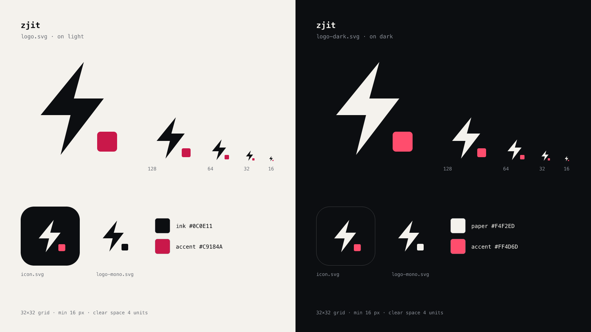

# zjit logo

A bolt for **just in time**, with the byte it just emitted in the accent: zjit writes machine code at run time, one instruction at a time.

The mark belongs to the [Pyrlyn](https://github.com/pyrlyn/brand/tree/main/logo/pyrlyn) family:
flat geometric shapes on a 32×32 grid, one ink colour and one accent, no gradients and no text.
Product logos stay primary; the Pyrlyn mark is for "by Pyrlyn" credits.

## Files

| File | Size | Format | Use |
|---|---|---|---|
| `logo.svg` | 32×32 viewBox | SVG | Mark for light backgrounds |
| `logo-dark.svg` | 32×32 viewBox | SVG | Mark for dark backgrounds |
| `logo-mono.svg` | 32×32 viewBox | SVG | One colour, `currentColor`: inline SVG, masks, print |
| `favicon.svg` | 32×32 viewBox | SVG | Follows the browser `prefers-color-scheme` |
| `icon.svg` | 32×32 viewBox | SVG | Mark at 62.5% on a rounded tile (corner radius 22.5%) |
| `png/logo-{16,32,64,128,256,512}.png` | 16–512 px square | PNG, RGBA, transparent | Light-background mark |
| `png/logo-dark-{16,32,64,128,256,512}.png` | 16–512 px square | PNG, RGBA, transparent | Dark-background mark |
| `png/icon-180.png` | 180×180 | PNG, opaque tile | Apple touch icon |
| `png/icon-512.png` | 512×512 | PNG, opaque tile | Avatar, social, store listings |
| `preview.png` | 1600×900 | PNG | Preview sheet: light and dark, true sizes 16–128, tile, mono, colours |

All SVGs are pure vector paths: no embedded raster, no fonts. The PNGs are exported from the SVGs
with [resvg](https://github.com/linebender/resvg) 0.49 (`resvg -w N -h N logo.svg png/logo-N.png`).

## Colours

| Token | Hex | Use |
|---|---|---|
| Ink | `#0C0E11` | Mark on light backgrounds |
| Paper | `#F4F2ED` | Mark on dark backgrounds |
| Accent (on light) | `#C9184A` | Accent shapes on light backgrounds |
| Accent (on dark) | `#FF4D6D` | Accent shapes on dark backgrounds |
| Tile | `#0C0E11` | Background of `icon.svg` |

## Usage

- Clear space: at least 4 grid units (1/8 of the mark box) on every side.
- Minimum size: 16 px. Below 32 px prefer `favicon.svg` or the 16/32 px PNGs.
- Themed pages: switch `logo.svg` / `logo-dark.svg` with the theme, use `<picture>` with
  `prefers-color-scheme`, or inline `logo-mono.svg` and set `color`.
- Do not recolour, rotate, outline or add effects to the mark. The accent is the only second colour.
- Use `icon.svg` / `png/icon-*.png` wherever the platform draws its own frame (app icons, avatars).

## Geometry

32×32 grid; at 16 px one pixel is 2 units. Shapes keep at least 1 unit of margin inside the box and
gaps of at least 2 units between them, so it stays readable at 16 px.
